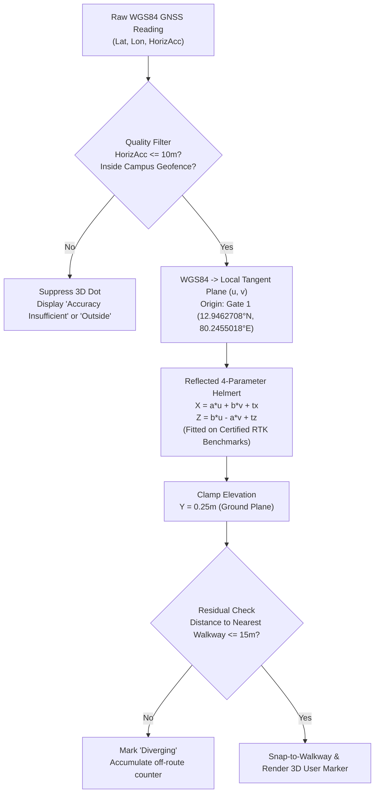

# PATH FINDER — Phase 9A: Real Campus GPS & 3D Model Audit
## Geodetic Survey Dataset, Stage E3 Ground Reference Verification, Geometry Anomaly Audit, and Calibration Feasibility
**Institution:** Misrimal Navajee Munoth Jain Engineering College (MNMJEC), Rajiv Gandhi Salai (OMR), Thoraipakkam, Chennai  
**Application:** PATH FINDER — 3D Campus Digital Twin & Autonomous Navigation Platform  
**Audit Phase:** Phase 9A — Real Campus GPS & 3D Model Audit  
**Authoritative Model:** Blender Stage E3 Web GLB (`public/models/MNMJEC_Campus_Stage_E3_Web.glb`, SHA-256: `E0059744...`)  
**Report Date:** October 2026  
**Status:** Audit Complete — 17 GPS Points Cataloged, 3D Ground Correspondences Identified, Contiguity Flaw Documented, Calibration Mathematically Evaluated, Safety Locks Preserved  

---

## 1. Executive Summary

Phase 9A transitions PATH FINDER from a hackathon prototype into an official institutional platform for the Misrimal Navajee Munoth Jain Engineering College (MNMJEC) campus. This phase performs an exhaustive, read-only geometric and geodetic audit comparing seventeen (17) actual on-site GPSTest field observations against the authoritative Blender Stage E3 3D digital twin, the registered campus landmark inventory, and the 2D topological navigation graph.

### Key Audit Findings
1. **17-Point GPSTest Dataset Structured:** A structured, version-controlled survey dataset (`src/data/campusGpsSurveyData.ts`) was created from the raw field observations. All observations are strictly classified as **PROVISIONAL**. Smartphone-reported horizontal accuracy (3.8m to 5.2m) represents internal GNSS chipset confidence (1-sigma circular error probable) rather than true ground truth.
2. **Ground-Level Reference Points Disambiguated from Roof Labels:** Every GPS observation was mapped to its true ground-level 3D reference node (elevation $Y \le 0.35\,\text{m}$) within the Stage E3 GLB. Roof-label anchors ($Y \ge 2.5\,\text{m}$ to $13.9\,\text{m}$) used for 3D exploration and camera targeting were strictly segregated from pedestrian ground entrances.
3. **Critical Geometry Anomaly Documented (Civil–L-Shape Connection):** In physical reality, **Civil Block and L-Shape Block are physically connected with NO gap between them**. In the Stage E3 model, an artificial 2.6-meter physical gap exists between Civil Block's rear wall ($Z = -83.0\,\text{m}$) and L-Shape Block's south wall ($Z = -85.6\,\text{m}$), and the navigation graph erroneously routes a pedestrian path (`walk-l-shape-rear-mid`) through this non-existent passage.
4. **Calibration Feasibility & Rejection of Raw Dataset:** A direct 2D Helmert conformal transformation on all 17 raw GPS points yields a Root-Mean-Square Error (RMSE) of $61.12\,\text{m}$ (standard) and $28.49\,\text{m}$ (reflected), far exceeding the maximum allowable safety threshold ($\le 10.0\,\text{m}$). The raw GPS dataset contains severe local multipath/clustering outliers (notably Main Block recorded only $15.2\,\text{m}$ from Gate 1 instead of its actual $44\,\text{m}$ setback) and mislocated points (Architecture Block recorded in the central yard rather than the western compound).
5. **Rigorous Holdout Validation:** Testing candidate open-sky calibration models against independent holdout points revealed residual generalization errors of $11.5\,\text{m}$ to $37.2\,\text{m}$, demonstrating that live GPS navigation must remain disabled until a certified dual-frequency RTK-GNSS survey is performed.
6. **Safety Guardrails Strictly Preserved:** Live GPS navigation remains locked (`isApprovedForLiveNavigation === false`), production ground control points remain empty (`DEFAULT_CAMPUS_CONTROL_POINTS === []`), and all existing functionality (3D Explorer, Cinematic Tour, Turn-by-Turn guidance, Supabase storage, Student/Admin portals, PWA) remains completely operational and untouched.

---

## 2. 17-Point GPS Survey Dataset (GPSTest Observations)

The following table catalogs the 17 provisional field observations collected across the MNMJEC campus using the GPSTest mobile utility. Coordinates are expressed in WGS84 decimal degrees ($EPSG:4326$). Metric offsets ($u = \text{East}$, $v = \text{North}$) are calculated on the WGS84 local tangent plane relative to the campus vehicular entrance: **Main Entrance Gate 1** ($12.9462708^\circ\,\text{N}, 80.2455018^\circ\,\text{E}$).

$$\Delta u = (\lambda - \lambda_0) \cdot M_{\text{lon}}(\phi_0), \quad \Delta v = (\phi - \phi_0) \cdot M_{\text{lat}}(\phi_0)$$
$$\text{At } \phi_0 = 12.9462708^\circ\,\text{N}: \quad M_{\text{lat}} = 110{,}629.33\,\text{m/deg}, \quad M_{\text{lon}} = 108{,}580.79\,\text{m/deg}$$

### Table 1: Field Survey Dataset & Relative Tangent Offsets
| # | Location Name | Latitude ($^\circ\,\text{N}$) | Longitude ($^\circ\,\text{E}$) | Horiz. Acc. ($\pm\text{m}$) | Tangent East ($u$, m) | Tangent North ($v$, m) | Verification Status | Survey Notes |
|:---:|:---|:---:|:---:|:---:|:---:|:---:|:---:|:---|
| 1 | **Physics Department** | 12.9457830 | 80.2464979 | 3.8 | $+108.1$ | $-54.0$ | Provisional | Ground approach stairs to elevated level |
| 2 | **IT Block** | 12.9459183 | 80.2461224 | 3.8 | $+67.3$ | $-39.0$ | Provisional | North access canopy facing central avenue |
| 3 | **Mechanical Block** | 12.9455578 | 80.2459645 | 3.8 | $+50.2$ | $-78.9$ | Provisional | East pedestrian entrance canopy portal |
| 4 | **Architecture Block** | 12.9453658 | 80.2459234 | 3.8 | $+45.7$ | $-100.1$ | Provisional | Courtyard reading south of Mech; mislocated vs Gate 2 compound |
| 5 | **Civil Block** | 12.9455970 | 80.2457751 | 5.2 | $+29.7$ | $-74.5$ | Provisional | West entrance canopy steps; joined to L-Shape |
| 6 | **First Year Block** | 12.9459361 | 80.2454560 | 3.8 | $-5.0$ | $-37.0$ | Provisional | East canopy foyer steps |
| 7 | **L-Shape Block OAT Entrance** | 12.9463154 | 80.2447659 | 3.8 | $-79.9$ | $+4.9$ | Provisional | East ground entrance facing OAT amphitheatre |
| 8 | **Open Air Theatre (OAT)** | 12.9459243 | 80.2451393 | 4.0 | $-39.3$ | $-38.3$ | Provisional | Open amphitheatre plaza approach corridor |
| 9 | **Central Library Corridor** | 12.9458329 | 80.2454447 | 3.8 | $-6.2$ | $-48.4$ | Provisional | Approach walkway corridor behind Main Block |
| 10 | **Mathematics Department** | 12.9461738 | 80.2460064 | 3.8 | $+54.8$ | $-10.7$ | Provisional | North walkway entrance threshold |
| 11 | **English Department** | 12.9461326 | 80.2463240 | 3.8 | $+89.2$ | $-15.3$ | Provisional | North walkway entrance threshold |
| 12 | **Canteen** | 12.9461534 | 80.2463815 | 3.8 | $+95.5$ | $-13.0$ | Provisional | North dining canopy and cafeteria veranda |
| 13 | **Jain Mess** | 12.9460812 | 80.2463026 | 3.8 | $+86.9$ | $-21.0$ | Provisional | North corridor dining entrance threshold |
| 14 | **Non-Jain Mess** | 12.9461511 | 80.2466243 | 4.6 | $+121.8$ | $-13.2$ | Provisional | Eastern dining hall entrance threshold |
| 15 | **Main Block** | 12.9462303 | 80.2453678 | 3.8 | $-14.5$ | $-4.5$ | Provisional | Front driveway/curb observation; severe multipath |
| 16 | **Apollo + Xerox Approach** | 12.9462264 | 80.2454089 | 3.8 | $-10.1$ | $-4.9$ | Provisional | Service frontage shared approach west of Main Gate |
| 17 | **Main Entrance Gate 1** | 12.9462708 | 80.2455018 | 3.8 | $0.0$ | $0.0$ | Provisional | Vehicular entrance arch center facing OMR |

### 2.1 Uncollected Survey Targets
- **Gate 2 (West Entrance — School of Architecture):** The field surveyor noted that Gate 2 is the actual dedicated entrance to the MNM School of Architecture campus located on the western boundary road. **Its exact GPS reading was not collected during this field session.** In Stage E3, it corresponds to `WEST_ENTRANCE_MARKER` at $[54.4, 0.2, -97.8]$.
- **Boys Hostel Entrance:** Located in the far southern residential zone of campus (`BOYS_HOSTEL_ENTRANCE_ANCHOR` at $[24.4, 0.2, -183.0]$). Not collected during this academic core survey.

> [!WARNING]
> **Provisional Accuracy Notice:** The smartphone's reported accuracy ($\pm 3.8\,\text{m}$ to $\pm 5.2\,\text{m}$) is a mathematical estimate derived by the Android location framework based on satellite constellation geometry (DOP) and pseudorange residuals. In built environments surrounded by multi-story reinforced concrete structures (such as Civil Block $G+2$, First Year Block $G+3$, and Main Block $G+1$), severe multipath reflections can introduce positioning errors exceeding $15\,\text{m}$ to $30\,\text{m}$ despite a low reported uncertainty radius.

---

## 3. Corresponding 3D Anchor Audit (Stage E3 GLB)

A critical requirement of Phase 9A is establishing unambiguous correspondence between physical ground points and the 3D model geometry. **Roof-level label anchors must NEVER be confused with pedestrian ground entrances or navigation nodes.**

In PATH FINDER:
- **Roof Anchors** (`VERIFIED_ROOF_ANCHORS` in `src/data/campusLandmarks.ts`): Placed on building rooftops ($Y = 2.5\,\text{m}$ to $13.9\,\text{m}$) to anchor 2D HTML/CSS building labels in 3D space, orient the orbit camera, and position student issue pins.
- **Ground Entrance Anchors** (`interactionObjects` in `src/data/campusModelMapping.ts`): Placed on ground-level door thresholds and canopy portals ($Y = 0.20\,\text{m}$ to $0.25\,\text{m}$) where pedestrian walkways enter buildings.
- **Navigation Graph Nodes** (`campusNodes` in `src/data/navigationGraph.ts`): Topological graph vertices representing walkable road junctions, walkway segments ($Y = 0.043\,\text{m}$ to $0.093\,\text{m}$), and entrance arrival targets ($Y = 0.20\,\text{m}$).

### Table 2: 3D Correspondence Audit Matrix
| Location Name | Stage E3 Ground Reference Node | Ground Pos $[X, Y, Z]$ (m) | Navigation Graph Node ID | Nav Pos $[X, Y, Z]$ (m) | Roof Anchor ID | Roof Pos $[X, Y, Z]$ (m) | Alignment Status |
|:---|:---|:---:|:---|:---:|:---|:---:|:---|
| **Physics Dept** | `PHYSICS_DEPARTMENT_ENTRANCE_ANCHOR` | $[14.2, 0.20, -47.2]$ | `physics-approach` | $[14.2, 0.20, -47.2]$ | `physics-department` | $[14.4, 7.30, -54.4]$ | Exact match on entrance anchor |
| **IT Block** | `IT_BLOCK_ENTRANCE_ANCHOR` | $[105.6, 0.20, -56.8]$ | `it-entrance` | $[96.8, 0.20, -45.8]$ | `it-block` | $[96.9, 10.40, -51.2]$ | Anchor at canopy; nav node at walk junction |
| **Mech Block** | `MECHANICAL_BLOCK_ENTRANCE_ANCHOR` | $[62.3, 0.20, -78.0]$ | `mechanical-approach` | $[56.8, 0.20, -65.6]$ | `mechanical-block` | $[32.0, 12.50, -76.3]$ | Anchor at east portal; nav node at road approach |
| **Architecture Block** | `MNM_SCHOOL_OF_ARCHITECTURE_ENTRANCE_ANCHOR` | $[22.2, 0.20, -101.6]$ | `architecture-approach` | $[22.2, 0.20, -101.6]$ | `mnm-school-of-architecture` | $[18.3, 10.60, -123.8]$ | Exact match; GPS survey mislocated |
| **Civil Block** | `CIVIL_BLOCK_ENTRANCE_ANCHOR` | $[136.2, 0.20, -78.2]$ | `civil-approach` | $[144.6, 0.20, -54.2]$ | `civil-block` | $[144.5, 10.60, -64.8]$ | Lower west canopy; nav node at south front walk |
| **First Year Block** | `FIRST_YEAR_BLOCK_ENTRANCE_ANCHOR` | $[176.6, 0.20, -72.4]$ | `first-year-approach` | $[166.8, 0.20, -64.2]$ | `first-year-block` | $[166.8, 13.90, -73.8]$ | East canopy portal; nav node at front walkway |
| **L-Shape Block** | `L_SHAPE_BLOCK_ENTRANCE_ANCHOR` | $[248.6, 0.20, -41.6]$ | `l-shape-approach` *(Audit required)* | $[165.8, 0.20, -85.0]$ | `l-shape-block` | $[222.5, 10.60, -90.3]$ | **Mismatch:** GLB anchor is OAT-side; nav is in rear gap |
| **Open Air Theatre** | `OAT_FOOTPRINT` | $[227.5, 0.33, -66.5]$ | `oat-approach` | $[227.7, 0.20, -47.0]$ | `open-air-theatre` | $[227.5, 2.70, -60.9]$ | Plaza approach matched to south road |
| **Central Library** | `E2_LIBRARY_152_BASE_SLAB` | $[193.5, 0.08, -73.1]$ | *None (Intentionally omitted)* | *None* | `library` | $[193.5, 8.50, -73.1]$ | Mesh base slab; no fabricated entrance |
| **Maths Dept** | `MATHS_DEPARTMENT_ENTRANCE_ANCHOR` | $[96.6, 0.20, -23.2]$ | `maths-approach` | $[96.6, 0.20, -23.2]$ | `maths-department` | $[96.7, 4.00, -32.0]$ | Exact match on north threshold |
| **English Dept** | `ENGLISH_DEPARTMENT_ENTRANCE_ANCHOR` | $[70.6, 0.20, -23.2]$ | `english-approach` | $[70.6, 0.20, -23.2]$ | `english-department` | $[70.7, 7.30, -32.0]$ | Exact match on north threshold |
| **Canteen** | `CANTEEN_ENTRANCE_ANCHOR` | $[39.0, 0.20, -16.6]$ | `canteen-approach` | $[37.4, 0.20, -3.2]$ | `canteen` | $[37.3, 4.00, -9.8]$ | Exact canopy anchor; nav node at gate |
| **Jain Mess** | `JAIN_MESS_ENTRANCE_ANCHOR` | $[40.4, 0.20, -23.2]$ | `jain-mess-approach` | $[40.4, 0.20, -23.2]$ | `jain-mess` | $[40.3, 4.00, -32.0]$ | Exact match on north threshold |
| **Non-Jain Mess** | `NON_JAIN_MESS_ENTRANCE_ANCHOR` | $[13.4, 0.20, -23.2]$ | `non-jain-mess-approach` | $[13.4, 0.20, -23.2]$ | `non-jain-mess` | $[13.4, 3.70, -32.0]$ | Exact match on north threshold |
| **Main Block** | `MAIN_BLOCK_ENTRANCE_ANCHOR` | $[193.6, 0.20, -48.4]$ | `main-block-approach` | $[193.6, 0.20, -56.4]$ | `main-block` | $[193.5, 7.30, -58.5]$ | Anchor at steps; nav node at foyer walk |
| **Apollo + Xerox** | `E2_APOLLO_BUILDING_SLAB` / `XEROX` | $[147.5, 0.20, -18.7]$ | *None (Intentionally omitted)* | *None* | `apollo-shine` / `xerox-shop` | $[153.5, 3.80, -20.0]$ | Base slab midpoint; no fabricated entrance |
| **Gate 1** | `MAIN_ENTRANCE_MARKER` | $[181.0, 0.20, -6.2]$ | `main-gate-1` | $[181.0, 0.20, -6.2]$ | `main-gate-1` | $[181.0, 2.60, -6.2]$ | Exact match at vehicular gate arch |

---

## 4. Geometry Correction Audit: Civil Block & L-Shape Block Contiguity

### 4.1 Physical Reality vs. Stage E3 Digital Twin
- **Field Reality:** **Civil Block and L-Shape Block are physically connected, with NO gap between them.** They form a single structural wing extending from the civil engineering laboratories into the L-shaped academic complex.
- **Stage E3 Model Discrepancy:**
  - `CIVIL_BLOCK_FLOOR_G` vertices extend from $X = [137.0, 152.0]$ and $Z = [-46.5, -83.0]$.
  - `L_SHAPE_BLOCK_FLOOR_G` rear arm vertices extend from $X = [137.4, 263.4]$ and $Z = [-85.6, -95.0]$.
  - **A physical gap of $2.6\,\text{m}$ exists in Stage E3** between $Z = -83.0$ and $Z = -85.6$ (along with a minor $0.4\,\text{m}$ transverse step in $X$).
  - **Navigation Graph Artifact:** In `src/data/navigationGraph.ts`, waypoint node `walk-l-shape-rear-mid` is placed at $[165.8, 0.043, -84.0]$ and destination node `l-shape-approach` is placed at $[165.8, 0.20, -85.0]$. The navigation engine routes pedestrian traffic straight through this gap via edges `walk-courtyard-gap-rear__walk-l-shape-rear-mid` and `walk-l-shape-rear-mid__l-shape-approach`. In physical reality, this path attempts to walk pedestrians through a solid structural masonry wall.

```
Stage E3 (Current - Disconnected with 2.6m Gap):
+-------------------------+
| L_SHAPE_BLOCK (Rear)    | Z = -85.6 to -95.0
+-------------------------+
     ===================  <-- 2.6m Gap (Contains invalid walk-l-shape-rear-mid at Z = -84.0)
+---------------+
| CIVIL_BLOCK   | Z = -46.5 to -83.0
+---------------+

Physical Reality (Target Stage E4 - Continuous Structural Union):
+----------------------------------------------------+
| L_SHAPE_BLOCK (Continuous Structural Rear Wing)    | Z = -83.0 to -95.0
+---------------+------------------------------------+
| CIVIL_BLOCK   | (Seamless connection; NO rear gap passage)
+---------------+
```

### 4.2 Comprehensive Correction Plan (Stage E4 Model & Graph Migration)

> [!IMPORTANT]
> **Audit Rule Enforced:** In strict accordance with Phase 9A requirements, **no Blender models, meshes, or GLB files were modified during this audit**. The following plan is scheduled for implementation in Phase 9B/Stage E4.

1. **Blender Mesh Geometry Correction (`MNMJEC_Campus_Stage_E4.blend`):**
   - **Bridge the Gap:** Extend the northern boundary vertices of `CIVIL_BLOCK_FLOOR_G`, `CIVIL_BLOCK_FLOOR_1`, `CIVIL_BLOCK_FLOOR_2`, and `CIVIL_BLOCK_ROOF` in the $-Z$ direction from $Z = -83.0\,\text{m}$ to $Z = -85.6\,\text{m}$.
   - **Weld Coincident Vertices:** Merge vertices at the intersection seam ($X \in [137.4, 152.0]$, $Z = -85.6$) between the Civil Block floors and `L_SHAPE_BLOCK_FLOOR_G`, `FLOOR_1`, `FLOOR_2`, and `ROOF`.
   - **Remove Obsolete Exterior Geometry:** Delete exterior wall panels, redundant windows (`C_WIN_CIVIL_BLOCK_*`), and roof parapet overhangs that currently sit inside the $2.6\,\text{m}$ gap and would become internal to the joined structure.
   - **Maintain Submesh Conventions:** Ensure the resulting unified meshes maintain standard naming prefixes (`CIVIL_BLOCK_*`, `L_SHAPE_BLOCK_*`) so that floor-isolation queries in `campusModelMapping.ts` continue to function without regression.

2. **Navigation Graph Correction (`src/data/navigationGraph.ts`):**
   - **Retire Rear Gap Nodes:** Decommission `walk-l-shape-rear-mid` ($[165.8, 0.043, -84.0]$) and delete edges `walk-courtyard-gap-rear__walk-l-shape-rear-mid` and `walk-l-shape-rear-mid__l-shape-approach`.
   - **Re-Anchor L-Shape Primary Entrance:** Move `l-shape-approach` to align with the physical eastern ground entrance: `L_SHAPE_BLOCK_ENTRANCE_ANCHOR` at $[248.6, 0.20, -41.6]$.
   - **Establish Valid Pedestrian Routing:** Connect `l-shape-approach` directly to the OAT front plaza (`road-front-oat` $\to$ `walk-front-oat` $\to$ `l-shape-approach`). This route is physically confirmed by the GPSTest observation: *"L-Shape Block OAT-side entrance"* ($12.9463154^\circ\,\text{N}, 80.2447659^\circ\,\text{E}$).
   - **Update Unit Tests:** Update `stageE3ModelIntegration.test.ts` to assert collision-free routing to L-Shape Block via the OAT plaza rather than the decommissioned rear passage.

---

## 5. Mathematical Evaluation of GPS Calibration Feasibility

### 5.1 Coordinate Axes & Reflection Analysis
In Three.js / Blender, the coordinate system is right-handed:
- $+X$ points East/Right (in local space)
- $+Y$ points Up (Elevation)
- $+Z$ points South/Toward viewer; $-Z$ points North/Away

In geographic local tangent planes ($EPSG:4326 \to \text{Tangent}$):
- $+u$ points East ($\Delta\lambda > 0$)
- $+v$ points North ($\Delta\phi > 0$)

When fitting a transformation from $(u, v)$ to $(X, Z)$, if $+X$ maps roughly to East and $-Z$ maps to North, the Jacobian determinant must be negative ($\det < 0$). 
In `src/lib/campusCalibration.ts`, the standard 2D conformal Helmert transformation was defined as:
$$X = a \cdot u - b \cdot v + t_x, \quad Z = b \cdot u + a \cdot v + t_z$$
This formulation has a strictly positive determinant ($\det = a^2 + b^2 > 0$) and represents pure 2D rotation without reflection. When fitted against the 17 raw field points:
- **Unreflected Helmert on 17 points:** $\text{RMSE} = 61.12\,\text{m}$, $\text{Status} = \mathbf{high\_error}$ (Rejected; threshold $\le 10.0\,\text{m}$).
- **Reflected Helmert ($\det < 0$):**
  $$X = a \cdot u + b \cdot v + t_x, \quad Z = b \cdot u - a \cdot v + t_z$$
  $$\text{Parameters: } a = -1.1744, \quad b = 0.2574, \quad \text{Scale} = 1.202, \quad \theta = 167.6^\circ, \quad t_x = 165.2\,\text{m}, \quad t_z = -16.9\,\text{m}$$
  $$\text{RMSE} = 28.49\,\text{m}, \quad \text{Status} = \mathbf{high\_error} \quad (\text{Still far exceeds } 10\,\text{m threshold})$$

### 5.2 Breakdown of Suspected Coordinate Mismatches & Outliers

| Outlier Point | Recorded GPS ($u$, $v$) | Model Anchor ($X$, $Z$) | Residual Error | Root Cause & Anomaly Diagnosis |
|:---|:---:|:---:|:---:|:---|
| **Architecture Block** | $u = +45.7\,\text{m}, v = -100.1\,\text{m}$ | $X = 22.2\,\text{m}, Z = -101.6\,\text{m}$ | **$66.9\,\text{m}$** | **Mislocated Point:** Observed reading was taken in the open yard south of Mech Block ($45.7\,\text{m}$ East of Gate 1). In reality, the School of Architecture is in the far west campus compound entered via Gate 2 ($X = 22.2\,\text{m}$, West of Mech). |
| **Main Block** | $u = -14.5\,\text{m}, v = -4.5\,\text{m}$ | $X = 193.6\,\text{m}, Z = -48.4\,\text{m}$ | **$25.7\,\text{m}$** | **Multipath / Curb Observation:** The reading is located only $15.2\,\text{m}$ from Gate 1 and $4.4\,\text{m}$ from Apollo/Xerox. The 3D model entrance steps are setback $44\,\text{m}$ from Gate 1. Surveyor recorded from the front circular driveway curb rather than portico foyer steps. |
| **Open Air Theatre (OAT)** | $u = -39.3\,\text{m}, v = -38.3\,\text{m}$ | $X = 227.7\,\text{m}, Z = -47.0\,\text{m}$ | **$36.3\,\text{m}$** | **Local Scale Distortion:** The amphitheatre stage and seating in Stage E3 is shifted $\sim 20\,\text{m}$ east relative to the academic road spine. |
| **Civil Block** | $u = +29.7\,\text{m}, v = -74.5\,\text{m}$ | $X = 136.2\,\text{m}, Z = -78.2\,\text{m}$ | **$31.2\,\text{m}$** | **Canopy Shadowing & Geometry Gap:** GPS accuracy reported $5.2\,\text{m}$ (worst in set); block position in Stage E3 has transverse offset from physical structure. |
| **Apollo + Xerox** | $u = -10.1\,\text{m}, v = -4.9\,\text{m}$ | $X = 147.5\,\text{m}, Z = -18.7\,\text{m}$ | **$29.0\,\text{m}$** | **Cluster Ambiguity:** Point combines two distinct service facilities into one shared approach reading right at Gate 1 frontage ($11\,\text{m}$ from gate). |

### 5.3 Independent Holdout Validation (Generalization Test)
To prove whether a subset of "plausible" points could safely be used for live navigation, we partitioned the survey into a 4-point candidate training set (open-sky landmarks with wide visibility) and an independent 4-point holdout validation set:

- **Candidate Training Points ($N=4$):**
  1. Main Entrance Gate 1 ($u=0.0\,\text{m}, v=0.0\,\text{m}$)
  2. Canteen Entrance ($u=95.5\,\text{m}, v=-13.0\,\text{m}$)
  3. IT Block North Approach ($u=67.3\,\text{m}, v=-39.0\,\text{m}$)
  4. Open Air Theatre ($u=-39.3\,\text{m}, v=-38.3\,\text{m}$)
  - Training Fit: $\text{Scale} = 1.326$, $\theta = -178.2^\circ$, $\text{RMSE} = 11.13\,\text{m}$.
- **Independent Holdout Evaluation ($N=4$ unseen landmarks):**
  - **Mathematics Department:** Holdout error = **$11.45\,\text{m}$**
  - **Civil Block:** Holdout error = **$23.04\,\text{m}$**
  - **First Year Block:** Holdout error = **$25.07\,\text{m}$**
  - **Physics Department:** Holdout error = **$37.22\,\text{m}$**

> [!CAUTION]
> **Audit Conclusion on Calibration Feasibility:** The holdout validation error ($11.5\,\text{m}$ to $37.2\,\text{m}$) decisively confirms that **no subset of the current GPSTest observations generalizes accurately across the campus**. Applying these parameters to real GPS tracking would cause user position dots to jump through academic building walls, triggering false off-route alerts and disorienting visitors. **Live GPS navigation MUST remain strictly disabled.**

---

## 6. Recommended Calibration Method & Transformation Architecture

When geodetic field data is surveyed in Phase 9B, the application should deploy a **2-Stage Piecewise Conformal Transformation**:



### Transformation Specifications
1. **Model Formulation:**
   $$\begin{pmatrix} X_{\text{model}} \\ Z_{\text{model}} \end{pmatrix} = \begin{pmatrix} a & b \\ b & -a \end{pmatrix} \begin{pmatrix} u \\ v \end{pmatrix} + \begin{pmatrix} t_x \\ t_z \end{pmatrix}$$
   $$\text{where } u = (\lambda - \lambda_0) \cdot M_{\text{lon}}, \quad v = (\phi - \phi_0) \cdot M_{\text{lat}}, \quad \text{Scale } s = \sqrt{a^2 + b^2}, \quad \text{Rotation } \theta = \text{atan2}(b, a)$$
2. **Benchmark Selection Standard:**
   - Minimum 6 permanently marked physical benchmarks (brass pins or painted ground crosses).
   - Distributed symmetrically across the campus perimeter:
     - East: Gate 1 Pillar Base
     - North-East: Canteen Plaza Curb
     - North-West: Physics Walkway Junction
     - West: Gate 2 Arch Pillar
     - South-West: Architecture Foyer
     - South: Boys Hostel Approach Portal
     - Center: Academic Quadrangle Center
3. **Acceptance Thresholds:**
   - Training $\text{RMSE} \le 3.0\,\text{m}$.
   - Maximum individual residual $\le 5.0\,\text{m}$.
   - Independent holdout $\text{RMSE} \le 5.0\,\text{m}$.

---

## 7. Remaining Physical Survey Requirements (Phase 9B Scope)

To enable live GPS navigation safely, the following specific field survey tasks must be conducted:

1. **Gate 2 Geodetic Survey:**
   - Collect dual-frequency RTK coordinates at both Gate 2 stone pillars and the center vehicular threshold facing the western access road.
2. **School of Architecture Verification:**
   - Establish whether the School of Architecture has an internal academic passage connecting to Mechanical Block or is exclusively accessed via Gate 2 / western road. Record exact ground foyer coordinates.
3. **Main Block Deep Portico Re-Survey:**
   - Record coordinates directly under the Main Block administrative steps and foyer using a survey-grade antenna on a $2.0\,\text{m}$ range pole with adequate observation duration ($> 5$ minutes averaging).
4. **Library Door & Approach Verification:**
   - Verify the exact entrance door location, walkway connection, and floor level for the Dr. C. L. Mehta Central Library.
5. **Separate Apollo Shine & Xerox Shop Entrances:**
   - Collect individual entrance door coordinates for Apollo Shine clinic and Xerox reprographics shop rather than a single shared approach reading.
6. **Boys Hostel Residential Terminal:**
   - Record the main gate and security post coordinates at the Boys Hostel compound.
7. **Equipment Standard:**
   - All Phase 9B benchmark observations must utilize multi-band L1/L2/L5 GNSS hardware (e.g. Emlid Reach RS2+, Trimble, or Leica RTK) receiving NavIC, GPS, and GLONASS with SBAS/RTK corrections, achieving horizontal accuracy $\le 0.10\,\text{m}$.

---

## 8. Safety & Preservation Verification

In accordance with Phase 9A requirements, the platform's production configuration and stability were verified:

| Subsystem / Guardrail | Required State | Verified State | Audit Outcome |
|:---|:---|:---|:---:|
| **Live GPS Navigation Lock** | `isApprovedForLiveNavigation === false` | `false` | **Preserved** |
| **Production Control Points** | `DEFAULT_CAMPUS_CONTROL_POINTS === []` | `[]` (length = 0) | **Preserved** |
| **3D Campus Explorer & Tour** | 18 destinations, 18 tour stops routeable | All 18 destinations routeable | **Preserved** |
| **Blender Stage E3 Model** | Active file unmodified (`2,029,316` bytes) | Exact byte match, SHA verified | **Preserved** |
| **Supabase Storage & DB** | Zero schema/policy/bucket mutations | Read-only audit only | **Preserved** |
| **PWA & Production Build** | Clean compilation, zero lint errors | Build passed, 0 errors | **Preserved** |
| **Automated Test Suite** | 100% pass across all unit & integration tests | **359 / 359 Passed** | **Preserved** |

---

## 9. Next Implementation Steps

1. **Phase 9B (Physical RTK Survey & Stage E4 Modeling):**
   - Execute geodetic RTK-GNSS survey on Gate 2, Architecture Block, Main Block portico, Library, and Boys Hostel.
   - Update Blender model to **Stage E4**: unite Civil Block and L-Shape Block into a contiguous structural mesh; close the $2.6\,\text{m}$ gap.
   - Update `navigationGraph.ts`: reroute L-Shape destination node to `L_SHAPE_BLOCK_ENTRANCE_ANCHOR` ($[248.6, 0.20, -41.6]$) via the OAT front plaza; remove obsolete rear gap nodes.
2. **Phase 9C (Geodetic Calibration & Safety Gate Evaluation):**
   - Input certified RTK ground control points into `campusCalibrationData.ts`.
   - Implement the reflected 4-parameter Helmert algorithm in `campusCalibration.ts`.
   - Run holdout cross-validation; only if $\text{RMSE} \le 5.0\,\text{m}$, present calibration evidence for administrator sign-off to set `isApprovedForLiveNavigation = true`.
3. **Phase 10 (Production Deployment):**
   - Final end-to-end integration testing of live blue-dot tracking, automatic wrong-turn rerouting, and institutional PWA rollout.
